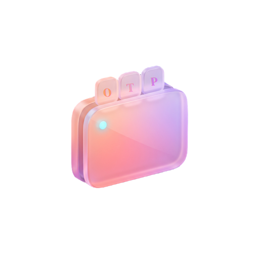

# AETHER

<p align="left">
  
</p>

[](https://github.com/NilambarSonu/AETHER/actions/workflows/macos-build.yml)
[](LICENSE)
[](https://www.apple.com/macos/)
[](https://support.apple.com/en-us/HT211814)

**AETHER** is a privacy-first, local 2FA verification code, sign-in link, and Bitwarden TOTP authenticator engine evolved from [CodeCatch](https://github.com/ugzv/CodeCatch) — packaged as a **standalone `AETHER.droplet`** (`DroppyKit v1.23.0+`) that runs directly inside [Droppy](https://getdroppy.app) with **no companion app or helper daemon required**.

---

## 1. Architecture & Core Principles

AETHER runs inside one self-contained Droppy droplet bundle (`Droplet/`):

- **Zero Companion App Needed:** Messages monitoring (`~/Library/Messages/chat.db`), Apple Mail (`~/Library/Mail`), Gmail OAuth PKCE + REST API, Microsoft Outlook / 365 OAuth PKCE + Graph API, iCloud/Yahoo/custom TLS IMAP, Bitwarden CLI TOTP import, privacy/clipboard controls, auto-type, and MCP agent access all live inside `AetherEngine` + `CodeCatchCore` inside `AETHER.droplet`.
- **Clean Settings vs. Notch Separation:** All setup, mail account authentication, Bitwarden TOTP import, privacy switches, recovery emails, and agent rules live strictly inside **Droppy → Settings → Droplets → AETHER** (`SettingsPagesProviding`). Droppy's **Notch Shelf (`ShelfWidgetCompositionProviding`)**, **Command Center (`MenuBarExtraProviding`)**, **Notch HUD (`HUDPresenting`)**, and **Notification Banners** stay focused exclusively on inspecting, copying, and opening codes and sign-in links.
- **Zero-Secret Disk Persistence:** Caught codes and unmatched recovery emails remain in memory only and never write plaintext codes to disk or logs. Keys and mail tokens live in macOS Keychain scoped to `app.getdroppy.droplet.aether`, protected by Touch ID / macOS authentication (`VaultSession`).
- **Process Trust Boundary:** `AETHER.droplet` is dynamically loaded (`dlopen`) into `Droppy.app` (`iordv.Droppy`, Team ID `NARHG44L48`). It shares Droppy's process address space and entitlements (including Full Disk Access & Accessibility once granted to Droppy) and is **not** an independent macOS App Sandbox. Co-loaded droplets inside `Droppy.app` share the same runtime process context.
- **Legacy Host / IPC Compatibility Preserved:** Root `CodeCatch`, `CodeCatchCLI`, `AetherCore`, and synchronized `AetherIPC` sources remain intact in the repository and test suites.

---

## 2. Current Implementation Status

- [x] **Phase 1.1–1.2:** IPC Security Verification & Peer Validator Foundation
- [x] **Phase 2A–2B:** Provider Modernization, FSEvents Event-Driven Engine & Icon Privacy
- [x] **Phase 3A–3F:** Headless `AetherCore`, Length-Prefixed Framing, Kernel Audit Token Validation & Official `DroppyKit` Droplet Integration
- [x] **Phase 4:** Standalone **`AETHER.droplet` v2.2.0** (`DroppyKit v1.23.0`) — Full parity inside Droppy (`SettingsPagesProviding`, `ShelfWidgetCompositionProviding`, `MenuBarExtraProviding`, `HUDPresenting`, `LiveActivityProviding`, `MCPToolProviding`), first-party verified Google & Microsoft OAuth Client IDs, DMARC anti-spoof auto-copy blocking, context-aware Accessibility Auto-Type guardrails, configurable Clipboard TTL with previous-clipboard restoration, Spam/Junk opt-in, 50 ms `FSEventWatcher`, IMAP idle wake signal, LZMA-compressed Public Suffix List, and stripped compact bundle packaging

---

## 3. Standalone Droplet Layout

```
Aether/
├── Droplet/                          # Official DroppyKit v1.23.0 standalone droplet
│   ├── Package.swift                 # CodeCatchCore + AetherEngine + AETHER + AETHERHarness (slim link)
│   ├── Package.resolved              # Pinned DroppyKit v1.23.0 (11e48698...)
│   ├── droplet.json                  # Manifest: settings-pane, menu-bar-extra, shelf-widget, live-activity, hud
│   ├── Assets/aether.png             # Universal AETHER 3D OTP squircle emblem (512x512)
│   ├── LICENSE & NOTICE.md           # GPLv3 license & upstream attribution
│   └── Sources/
│       ├── CodeCatchCore/            # Deterministic OTP extraction, MIME, TOTP, links, identity rules (704 fixtures)
│       ├── AetherEngine/             # Headless Messages, Mail, OAuth PKCE, IMAP, Bitwarden, Agents, Vault, Clipboard
│       ├── AetherIPC/                # Synchronized IPC frame codecs & transport client
│       ├── AETHER/                   # AETHERPrincipal, AetherDroplet, Droppy bridges, Settings & Notch SwiftUI views
│       └── AETHERHarness/            # Official DropletHarnessApp target
├── Sources/                          # Legacy host modules & CLI preserved in workspace
├── Tests/
│   ├── CodeCatchCoreTests/           # 704 OTP extraction fixtures + MIME/TOTP/link suites
│   ├── AetherEngineTests/            # Standalone engine, OAuth PKCE, Bitwarden, skills & agent safety tests
│   ├── AetherCoreTests/              # Transport, hardening & Droplet manifest/linkage parity tests
│   └── CodeCatchTests/               # Host integration tests
└── scripts/
    ├── build-droplet.sh              # Official DroppyKit build/validate & safe staged installer
    ├── prepare-droplet-icon.sh       # Generates .droppykit/AETHER.icon from Droplet/Assets/aether.png
    ├── test.sh                       # Full workspace test suite runner
    └── install.sh                    # Packaging utility
```

---

## 4. Requirements & Building

- **macOS:** 15.0+ (Droppy `16.2.0+` with DroppyKit `1.23.0+`)
- **Architectures:** Universal `arm64` + `x86_64` when built with `droppykit build` (Xcode 26+ SDK)
- **Toolchain:**
  - Root test suites (`./scripts/test.sh`) and core/engine targets compile and pass under Command Line Tools (`Swift 6.x`).
  - Official `.droplet` packaging (`droppykit build`, `droppykit validate`, `droppykit lint --strict`, `droppykit run`) requires **Xcode 26+** and runs automatically on GitHub Actions (`macos-15`).

### Lint & Test Locally

```bash
# Run strict DroppyKit static lint checks
python3 ../droppykit/Scripts/lint-droplet.py --package ./Droplet --no-binary --strict

# Run workspace unit & hardening tests
./scripts/test.sh --force-resolved-versions
```

See [`docs/README-TESTING.md`](docs/README-TESTING.md) for Droppy Playground & Droppy installation steps, and [`docs/phase-4-standalone-droplet-architecture.md`](docs/phase-4-standalone-droplet-architecture.md) for full architectural specifications.

---

## 5. Security Disclosure

Refer to [`SECURITY.md`](SECURITY.md) for private disclosure instructions and full trust boundary documentation.

---

## 6. License & Upstream Attribution

AETHER is licensed under the **GNU General Public License v3.0 (GPLv3)**. See [`LICENSE`](LICENSE) and [`NOTICE.md`](NOTICE.md).

Evolved from **CodeCatch** (Copyright (C) 2024–2026 Uros and CodeCatch contributors). Standalone AETHER droplet & engine integrations Copyright (C) 2026 Nilambar Behera.
