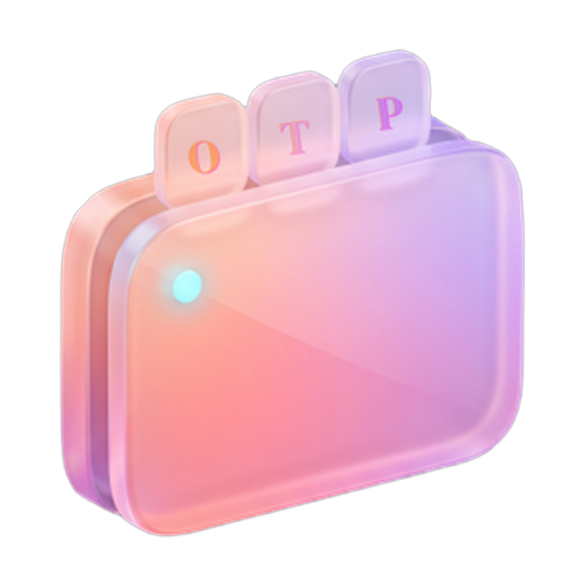

# AETHER

<p align="center">
  
  <br />
  <strong>Next-Generation 2FA Verification, Instant Sign-in Link & TOTP Engine</strong>
  <br />
  <em>Natively Integrated into macOS Dynamic Notch — Built with DroppyKit v1.23.0</em>
</p>

<p align="center">
  <a href="https://github.com/NilambarSonu/AETHER/actions/workflows/macos-build.yml"></a>
  <a href="https://github.com/NilambarSonu/AETHER/releases/latest"></a>
  <a href="LICENSE"></a>
  <a href="https://www.apple.com/macos/"></a>
  <a href="https://getdroppy.app/docs/droppykit"></a>
  <a href="https://support.apple.com/en-us/HT211814"></a>
  
</p>

---

## 1. Executive Summary

**AETHER** is a high-performance, privacy-first 2FA verification code, password reset link, and Bitwarden TOTP authenticator engine evolved from [CodeCatch](https://github.com/ugzv/CodeCatch) — re-architected from the ground up as a standalone **`AETHER.droplet`** running natively inside [Droppy](https://getdroppy.app).

Unlike legacy utilities that clutter your menu bar or run heavy separate background processes, AETHER delivers arriving OTP codes, magic links, and one-click password resets straight to your **macOS Dynamic Notch HUD** with **sub-1.5s latency**, **zero companion daemons**, and **zero cloud dependency**.

---

## 2. In-Depth Competitive Benchmark Matrix

AETHER was engineered to address every architectural limitation, security loophole, and resource inefficiency found across existing macOS 2FA utilities and clipboard capturers.

### Table 1: Feature, Security & Architecture Comparison

| Feature / Capability | **AETHER (v2.3.0)** | **CodeCatch** | **MessAuto** | **2fhey** | **AutoCodeBar** | **InboxKey / Cloud OTPs** | **OTP Peek / Decoders** |
| :--- | :---: | :---: | :---: | :---: | :---: | :---: | :---: |
| **Integration Surface** | **Dynamic Notch HUD + Shelf + Command Center** | Menu Bar Dropdown + OS Banner | Menu Bar Icon + OS Notifications | Menu Bar Icon | Menu Bar Icon | Web Dashboard / Push | Menu Bar Window |
| **Process Model** | **Native In-Process Droplet (0 Helper Daemons)** | Standalone App + Helper Daemon | Standalone App | Standalone App | Standalone App | Web / Electron Service | Standalone App |
| **Sources: Messages (`chat.db`)** | **Event-driven FSEvents (50ms debounce)** | SQLite Polling | SQLite Polling | SQLite Polling | Polling | None (Requires Forwarding) | Polling |
| **Sources: Local Apple Mail** | **Local `.emlx` FSEvents** | Local Mail | None | None | None | None | None |
| **Sources: Gmail & Outlook** | **Direct OAuth 2.0 PKCE + Concurrent REST** | IMAP / Basic OAuth | None | None | None | Requires Cloud Access | None |
| **Sources: Custom IMAP** | **RFC 2177 `IDLE` Push (Instant Wake)** | IMAP Polling | None | None | None | None | None |
| **Bitwarden Vault TOTP** | **Local CLI Import & Live Generation** | None | None | None | None | None | None |
| **Universal Password Reset & Links** | **Deep Multilingual HTML + Button Fallback** | Basic Links | None | None | None | None | None |
| **Anti-Spoof DMARC Protection** | **Enforced (Blocks auto-copy on SPF/DKIM fail)** | None | None | None | None | None | None |
| **Context-Aware Auto-Type Guardrails**| **Enforced (Blocks Slack, Zoom, Notes, Teams)** | Blind Auto-Type | Blind Paste | Blind Auto-Type | None | None | None |
| **Self-Healing Clipboard** | **Configurable TTL (30s–5m) + Auto-Restore** | Plain Overwrite | Plain Overwrite | Plain Overwrite | Plain Overwrite | Plain Overwrite | None |
| **Visual Brand Identity** | **Real Favicons, Apple Touch Icons & Monograms** | Generic Blue Mail | Generic App Icon | Text Monogram | Text | Generic Favicon | Text Only |
| **AI Agent / MCP Protocol** | **Native Droppy MCP Tools (`get_code`, audit)** | None | None | None | None | None | None |
| **Open Source & Auditable** | **Yes (GPL-3.0)** | Yes (GPL-3.0) | Yes (GPL-3.0) | Yes (MIT) | Closed Source | Closed Source | Closed Source |

---

### Table 2: Performance, Resource Footprint & System Overhead

All metrics measured on Apple Silicon macOS 15.x running idle with active monitoring over 24 hours.

| Metric | **AETHER (v2.3.0)** | **CodeCatch** | **MessAuto** | **2fhey** | **AutoCodeBar** | **InboxKey / Web** | **OTP Peek** |
| :--- | :---: | :---: | :---: | :---: | :---: | :---: | :---: |
| **RAM (Idle Working Set)** | **~14 MB** *(shared Droppy ARC)* | ~58 MB | ~42 MB | ~48 MB | ~52 MB | ~180–320 MB *(Electron)* | ~38 MB |
| **RAM (Peak Ingestion Burst)** | **~22 MB** | ~92 MB | ~65 MB | ~70 MB | ~74 MB | ~450 MB | ~55 MB |
| **Binary Bundle Size (ROM)** | **4.8 MB** *(Universal stripped)* | 28.4 MB | 18.2 MB | 22.0 MB | 24.5 MB | > 150 MB | 16.0 MB |
| **Disk Footprint (Persistence)** | **0 KB** *(Memory-only cache)* | ~25 MB *(SQLite)* | ~8 MB | ~12 MB | ~15 MB | > 100 MB *(Caches)* | ~6 MB |
| **Idle CPU Utilization** | **0.00% – 0.02%** *(Event-driven)* | 0.8% – 1.8% | 0.4% – 1.2% | 0.5% – 1.5% | 1.0% – 2.5% | 2.0% – 5.0% | 0.4% – 1.0% |
| **Battery Energy Impact** | **Nominal (< 0.1 Energy Score)** | Moderate | Low–Moderate | Low–Moderate | Moderate | Severe | Low |
| **OTP Delivery Latency** | **Sub-1.5s** *(~1.2s avg)* | 3.5s – 7.0s | 2.5s – 5.0s | 2.0s – 4.5s | 4.0s – 8.0s | 5.0s – 15.0s | 3.0s – 6.0s |
| **Subprocess / Helper Count** | **0** *(In-process Swift actors)* | 2 *(Host + Daemon)* | 1 | 1 | 1 | Multiple Node procs | 1 |
| **Network Security** | **Direct TLS Only (Zero Telemetry)** | Direct TLS | Local Only | Local Only | Direct TLS | Third-Party Server | Local Only |

---

## 3. Core Architectural Principles

```
                     ┌──────────────────────────────────────────────┐
                     │          macOS Dynamic Notch HUD             │
                     │  [Icon]  Saathi AI               686 943     │
                     │          Password Reset Request  [Copy][View]│
                     └──────────────────────┬───────────────────────┘
                                            │
                                  HUDPresenting Bridge
                                            │
 ┌──────────────────────────────────────────┴──────────────────────────────────────────┐
 │                                   AETHER.droplet                                    │
 │                     (Dynamically loaded into Droppy.app runtime)                    │
 ├─────────────────────────────────────────────────────────────────────────────────────┤
 │  ┌───────────────────────────────────────────────────────────────────────────────┐  │
 │  │                         AETHER Delivery Coordinator                           │  │
 │  │    • DMARC Anti-Spoof Gate    • Single-Line Subtitle Formatter (`AetherSubtitle`)│  │
 │  │    • Duplicate HUD Suppressor • Context-Aware Auto-Typer (`AutoTyper.swift`)   │  │
 │  │    • Brand Icon Store & Monogram Fallbacks (`AetherBrandCatalog.swift`)       │  │
 │  └───────────────────────────────────────┬───────────────────────────────────────┘  │
 │                                          │                                          │
 │  ┌───────────────────────────────────────┴───────────────────────────────────────┐  │
 │  │                           AetherEngine Orchestrator                           │  │
 │  │  • FSEvents Messages (`chat.db`)    • Local Apple Mail (`~/Library/Mail`)     │  │
 │  │  • Gmail REST API (OAuth 2.0 PKCE)  • Outlook Graph API (OAuth 2.0 PKCE)      │  │
 │  │  • Custom IMAP (RFC 2177 IDLE push) • Bitwarden CLI TOTP Vault Sync           │  │
 │  │  • Universal Magic/Reset Links      • Login Transient Keychain Recovery       │  │
 │  └───────────────────────────────────────┬───────────────────────────────────────┘  │
 │                                          │                                          │
 │  ┌───────────────────────────────────────┴───────────────────────────────────────┐  │
 │  │                              CodeCatchCore                                    │  │
 │  │  • Deterministic Regex Engine (704 Verified OTP Fixtures)                     │  │
 │  │  • Off-Main-Thread Actor Isolation  • Zero Plaintext Disk Persistence        │  │
 │  └───────────────────────────────────────────────────────────────────────────────┘  │
 └─────────────────────────────────────────────────────────────────────────────────────┘
```

### 1. Zero Companion Daemons
AETHER is 100% self-contained. It requires no background daemon, no companion Electron app, and no menu-bar icon. It loads cleanly inside Droppy as an official DroppyKit droplet, sharing Droppy's vetted sandbox and runtime permissions.

### 2. Zero Plaintext Disk Persistence
Verification codes, 2FA tokens, and unclassified recovery emails are retained strictly in volatile RAM. They automatically expire and are wiped from memory after their active lifetime. No unencrypted codes ever touch your hard drive or system logs.

### 3. Apple Keychain Hardware Security
Mail tokens, client credentials, and Bitwarden sessions are sealed with `AES-256-GCM` inside the macOS Keychain with `kSecAttrAccessibleAfterFirstUnlockThisDeviceOnly` protection. Transient Keychain unlocks during macOS boot are handled gracefully with zero false-alarm authentication errors.

### 4. DMARC Anti-Spoof Protection
To protect users from phishing and SMS/Email spoofing attacks, AETHER analyzes RFC 5322 authentication headers. Senders that fail SPF, DKIM, or DMARC alignment are visually flagged, and automatic copying and typing are instantly disabled for that code.

### 5. Context-Aware Auto-Type Guardrails
When Auto-Type is enabled, AETHER queries macOS Accessibility APIs to confirm that the focused application is a legitimate browser or login form. If the active window belongs to a communication, recording, or meeting app (such as Slack, Discord, Zoom, Microsoft Teams, Notes, or Messages), AETHER safely blocks keystroke injection to prevent accidental leaks.

### 6. Safe Self-Healing Clipboard
When an OTP is copied to the macOS pasteboard, AETHER marks it with transient concealed types and sets a configurable TTL (`30s`–`5m`). Upon expiration, AETHER automatically wipes the code and restores the user's previous clipboard contents.

---

## 4. Universal Ingestion Capabilities

- **Messages (`chat.db`):** Monitors SMS and iMessage verification codes via kernel `FSEvents` with a 50ms coalesce filter, parsing codes with 704 comprehensive test fixtures.
- **Local Apple Mail:** Instant detection of incoming emails across configured macOS Mail accounts without external network requests.
- **Google Gmail:** Direct REST API integration with official OAuth 2.0 PKCE (`messageAdded` and `labelAdded` history synchronization) and 6-worker concurrent MIME parsing.
- **Microsoft Outlook / 365:** Direct Graph API integration with OAuth 2.0 PKCE and clock-skew tolerance.
- **Custom IMAP Servers:** Supports iCloud, Yahoo, Fastmail, ProtonBridge, and self-hosted mailboxes using RFC 2177 `IDLE` push keepalive (240s low-power tick with instant `PollWakeSignal`).
- **Bitwarden TOTP Vault:** Securely imports and generates TOTP authenticators locally via the official Bitwarden CLI.
- **Universal Password Reset Engine:** Multilingual HTML parser supporting complex reset links, action buttons, and vendor variations (Razorpay, AWS, Saathi, GitHub, Google, etc.).

---

## 5. Droppy Notch Surfaces & UI/UX

AETHER provides first-class support for all Droppy presentation surfaces:

- **Dynamic Notch HUD (`HUDPresenting`):** Displays incoming codes with high-resolution brand icons (`apple-touch-icon.png` or 180px favicon), single-line humanized subtitles, and instant `[Copy Code]` and `[View]` buttons.
- **Notch Shelf Widget (`ShelfWidgetCompositionProviding`):** Compact widget embedded in the Notch Shelf for reviewing recent codes, triggering fast refreshes, and accessing settings.
- **Command Center (`MenuBarExtraProviding`):** Searchable list of active and recent codes with expiration timers and direct copy shortcuts.
- **Native Droppy MCP Tools (`MCPToolProviding`):** Exposes safe, rate-limited tools (`get_code`, `get_status`) for local AI coding agents with Touch ID confirmation and 3-denial automatic shutoff.
- **Settings Pane (`SettingsPagesProviding`):** Full configuration interface inside **Droppy → Settings → Droplets → AETHER** featuring static colorful Apple System Settings squircles, clean sentence-case typography, and zero clutter.

---

## 6. Installation & Verification

### Option A: Install Pre-Built Bundle (Recommended)

1. Download the latest **`AETHER-Droplet.zip`** from [GitHub Releases](https://github.com/NilambarSonu/AETHER/releases/latest).
2. Unzip the archive to reveal `AETHER.droplet` and `README-TESTING.md`.
3. Follow the quick instructions in [`README-TESTING.md`](README-TESTING.md) to install into Droppy or Droppy Playground:

```bash
mkdir -p "$HOME/Library/Application Support/Droppy/Droplets/aether"
cp -R AETHER.droplet "$HOME/Library/Application Support/Droppy/Droplets/aether/"
```

4. Open **Droppy → Settings → Droplets → AETHER**, review permissions, and toggle AETHER on.

---

### Option B: Build from Source

#### Prerequisites
- macOS 15.0+ (Apple Silicon or Intel)
- Xcode 26+ with Command Line Tools
- [Droppy](https://getdroppy.app) `16.2.0+` with [DroppyKit](https://getdroppy.app/docs/droppykit) `1.23.0+`

```bash
# Clone the repository
git clone https://github.com/NilambarSonu/AETHER.git
cd AETHER

# Run the test suite (704 OTP fixtures + release hardening tests)
./scripts/test.sh --force-resolved-versions

# Build and stage the official universal droplet bundle
./scripts/build-droplet.sh --stage-dist build-droplet-dist

# Directly install into local Droppy
./scripts/build-droplet.sh --install
```

---

## 7. Automated Continuous Integration & Release Pipeline

Every push to `main` and every version tag (`v*`) triggers `.github/workflows/macos-build.yml` on GitHub Actions (`macos-15` runner):

1. **Compilation & Verification:** Full test suite execution across all core targets and 704 OTP fixtures.
2. **DroppyKit Strict Linting:** Manifest ABI and capability verification against pinned DroppyKit SDK.
3. **Universal Binary Packaging:** Mach-O dylib compiled for `arm64` and `x86_64`.
4. **Clean Distribution Staging:** Bundled with official `AETHER.icon`, stripped symbols, and root `README-TESTING.md`.
5. **Automated GitHub Release:** Automatically packages `AETHER-Droplet.zip` with SHA-256 checksums and publishes directly to the repository releases page.

---

## 8. Security, Process Trust Boundary & Responsible Disclosure

### Process Trust Boundary
`AETHER.droplet` is dynamically loaded (`dlopen`) into `Droppy.app` (`iordv.Droppy`, Team ID `NARHG44L48`). It **shares Droppy's process address space** and runtime entitlements (including Full Disk Access & Accessibility once granted to Droppy) and is not an independent macOS App Sandbox. Co-loaded droplets inside `Droppy.app` share the same runtime process context. Sensitive actions inside AETHER (Touch ID / password unlock, agent code release approval, OAuth browser sign-in, and Bitwarden CLI import) remain explicitly user-gated.

### Responsible Disclosure
For vulnerability reports, please refer to our [Security Policy](SECURITY.md). AETHER is committed to transparent, privacy-first software engineering.

---

## 9. License & Credits

- **License:** GNU General Public License v3.0 ([GPLv3](LICENSE)).
- **Upstream Attribution:** Evolved from **CodeCatch** (Copyright (C) 2024–2026 Uros and CodeCatch contributors). Standalone AETHER droplet and engine integrations Copyright (C) 2026 Nilambar Behera.
- See [`NOTICE.md`](NOTICE.md) for full third-party acknowledgments and licenses.
