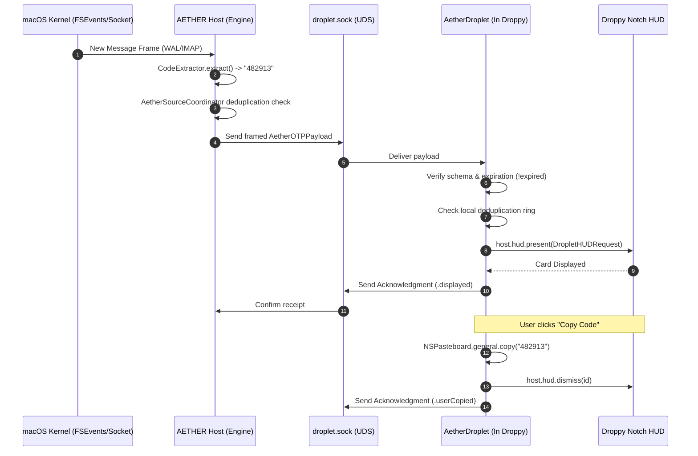

# AETHER Phase 3A — IPC Communication Contract & Protocol Specification

## 1. Executive Summary

This document specifies the communication contract between the **AETHER Host Process** (ingestion and extraction engine) and the **AetherDroplet** (DroppyKit notch presentation client).

The transport is an authenticated, local Unix Domain Socket (UDS) operating with strict memory isolation, zero disk persistence of OTP codes, fail-closed peer authentication, and replay suppression.

---

## 2. Transport Architecture & Security Boundary

```
+-----------------------------------------------------------------------------------------+
|                                    Current User Session                                 |
+-----------------------------------------------------------------------------------------+
|                                                                                         |
|  +---------------------------+                           +---------------------------+  |
|  |      AETHER Host App      |                           |    Droppy (Host App)      |  |
|  |    (Ingestion Engine)     |                           |   +---------------------+ |  |
|  |                           |                           |   |    AetherDroplet    | |  |
|  |  +---------------------+  |     Unix Domain Socket    |   |  (DroppyKit Notch)  | |  |
|  |  | DropletIPCServer    |  |  ~/.../Aether/droplet.sock|   |  +----------------+ | |  |
|  |  |  - Bind 0600        |==|===========================|===|==| DropletIPCClient| | |  |
|  |  |  - LOCAL_PEERTOKEN  |  |    (Framed JSON / 4KB max)|   |  +----------------+ | |  |
|  |  +---------------------+  |                           |   +---------------------+ |  |
|  +---------------------------+                           +---------------------------+  |
|                                                                                         |
+-----------------------------------------------------------------------------------------+
```

### 2.1 Transport Mechanism
- **Socket Path:** `~/Library/Application Support/Aether/droplet.sock`
- **File Permissions:** `0600` (Owner read/write only).
- **Framing:** Length-prefixed binary frames (4-byte big-endian UInt32 length header followed by UTF-8 encoded JSON payload).
- **Max Frame Size:** `4,096 bytes` (4 KB). Any message exceeding 4 KB is terminated without parsing to prevent buffer overflow attacks.

### 2.2 Peer Authentication
- Communication uses Darwin kernel audit tokens (`LOCAL_PEERTOKEN` socket option via `getsockopt`).
- **Server Verification of Client:** The AETHER host inspects the connecting client's audit token. It verifies that the peer matches the current macOS UID and is hosted inside `iordv.Droppy` (or local development identity).
- **Client Verification of Server:** The droplet verifies that the socket is owned by the current user UID and terminates if file ownership is tampered with.

---

## 3. Data Contract Specification

### 3.1 Event Payload (`AetherOTPPayload`)

```swift
/// An ephemeral verification code event transmitted from AETHER Host to AetherDroplet.
public struct AetherOTPPayload: Codable, Sendable {
    /// Schema version for forward/backward compatibility (Initial version: 1).
    public let schemaVersion: Int
    
    /// Unique identifier for this transmission instance.
    public let eventId: UUID
    
    /// Cryptographic deduplication signature (SHA-256 of code + source + timestamp).
    public let deduplicationHash: String
    
    /// Source origin identifier (e.g., "messages", "apple-mail", "work-imap").
    public let sourceKey: String
    
    /// Human-readable brand or service name (e.g., "GitHub", "Google", "PayPal").
    public let serviceLabel: String
    
    /// The sender address or phone number (e.g., "support@github.com", "SMS").
    public let senderDisplay: String
    
    /// The normalized verification code (digits or alphanumeric).
    public let code: String
    
    /// Timestamp when the message was detected by AETHER.
    public let createdAt: Date
    
    /// Absolute expiration timestamp after which the code is invalid.
    public let expiresAt: Date
    
    /// Recommended HUD card display duration in seconds (default: 30.0).
    public let displayDuration: Double
    
    /// Optional deep link URL associated with sign-in / verification.
    public let directActionURL: URL?

    public init(
        schemaVersion: Int = 1,
        eventId: UUID = UUID(),
        deduplicationHash: String,
        sourceKey: String,
        serviceLabel: String,
        senderDisplay: String,
        code: String,
        createdAt: Date = Date(),
        expiresAt: Date = Date().addingTimeInterval(300),
        displayDuration: Double = 30.0,
        directActionURL: URL? = nil
    ) {
        self.schemaVersion = schemaVersion
        self.eventId = eventId
        self.deduplicationHash = deduplicationHash
        self.sourceKey = sourceKey
        self.serviceLabel = serviceLabel
        self.senderDisplay = senderDisplay
        self.code = code
        self.createdAt = createdAt
        self.expiresAt = expiresAt
        self.displayDuration = displayDuration
        self.directActionURL = directActionURL
    }
}
```

### 3.2 Acknowledgment Payload (`AetherOTPAcknowledgment`)

```swift
public struct AetherOTPAcknowledgment: Codable, Sendable {
    public enum DeliveryStatus: String, Codable, Sendable {
        case displayed
        case suppressedDuplicate
        case rejectedExpired
        case userCopied
        case userDismissed
    }

    public let eventId: UUID
    public let status: DeliveryStatus
    public let timestamp: Date
}
```

---

## 4. Sequence Diagrams

### 4.1 Successful Ingestion & Ephemeral Presentation



### 4.2 Reconnection & Receiver Unavailable Fallback

```mermaid
sequenceDiagram
    autonumber
    participant Host as AETHER Host
    participant Socket as droplet.sock
    participant Droplet as AetherDroplet

    Note over Host, Droplet: Droppy is closed or AetherDroplet deactivated
    Host->>Socket: Check active client connections
    Socket-->>Host: No active client
    Host->>Host: Fallback to built-in AETHER MenuBar / HUD presentation
    Note over Host: Zero OTP loss; user still receives code
    Note over Droplet: Droppy starts / Droplet activates
    Droplet->>Socket: Connect()
    Socket->>Host: New peer connection
    Host->>Host: IPCPeerValidator.validate(peerToken)
    Host-->>Droplet: Handshake OK
```

---

## 5. Security & Privacy Guarantees

1. **Transient Memory Policy:**
   - `AetherOTPPayload` is never written to disk, SQLite, or UserDefaults by either process.
   - It resides exclusively in memory during its active display duration (default: 30s).
   - Once dismissed or expired, references are deallocated.
2. **Zero OTP Logging:**
   - Any diagnostic logging replacing the payload strings MUST use redaction:
     `os_log("Delivered OTP for %{public}@ [REDACTED %ld chars]", payload.serviceLabel, payload.code.count)`
3. **No Credential Exposure:**
   - No IMAP passwords, email account tokens, or message body context are included in `AetherOTPPayload`. Only the extracted OTP string and visual service label are sent.
4. **Replay Rejection:**
   - `expiresAt` is strictly enforced. Any event arriving with `Date() > expiresAt` is dropped immediately.
   - The droplet maintains an in-memory `Set<String>` of recent deduplication hashes (capacity: 50 items).
