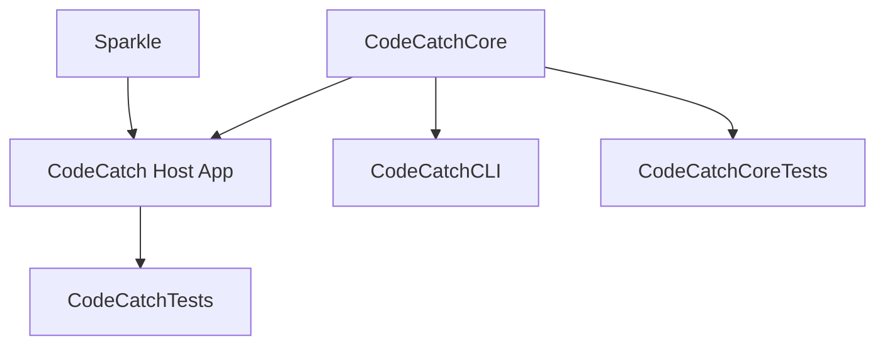
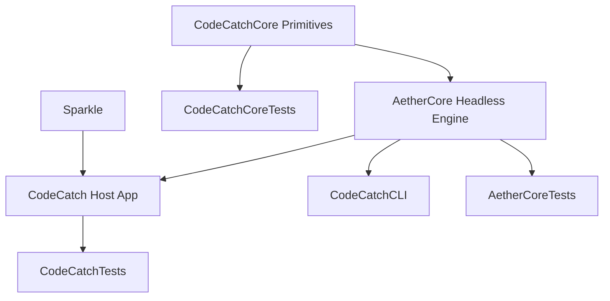

# AETHER Phase 3B — Headless AetherCore Module Extraction

## 1. Executive Summary

In Phase 3B, the headless, reusable domain core of AETHER was extracted into an internal Swift package target named **`AetherCore`**.

This extraction was executed strictly under the authorized **Option A (In-Process Engine with Droplet Bridge)** architecture. The host application (`CodeCatch`), CLI helper (`CodeCatchCLI`), packaging layout, bundle identifiers, and signing identities were 100% preserved.

### Key Achievements:
- Created internal target `AetherCore` with zero dependencies on AppKit, SwiftUI, Sparkle, or macOS Keychain.
- Extracted `AetherSourceCoordinator`, `AetherMailSource`, `IncomingMessage`, `SourceStatus`, and `SourceHealth` into `Sources/AetherCore/`.
- Re-exported foundation primitives (`@_exported import CodeCatchCore`) to maintain clean DAG dependencies.
- Added dedicated test target `AetherCoreTests` validating isolated core behavior.
- Total test coverage expanded from 279 to **284 passing tests across 23 suites** (100% pass rate, 0 failures, 0 regressions). All 704 OTP corpus samples verified in 0.420 seconds.
- Packaging verified via `scripts/install.sh --build-only` producing a universal, code-signed release `.app` bundle.

---

## 2. Target Architecture: Before & After

### Before Phase 3B

*Issue:* The modern concurrency engine (`AetherSourceCoordinator`), source protocols (`AetherMailSource`), and message models were intermingled with AppKit and SwiftUI UI components inside `Sources/CodeCatch/`.

### After Phase 3B

*Characteristics:*
- `CodeCatchCore` maintains low-level parsing primitives (MIME, Public Suffix List, TOTP, CodeExtractor).
- `AetherCore` is completely headless, managing provider abstraction, concurrent stream consumption, failure isolation, deduplication, and message models.
- `CodeCatch` acts as the host container holding system permissions (Full Disk Access, Keychain) and providing UI presentation.

---

## 3. Candidate-File Audit & Extraction Decisions

| Candidate Component | Original Path | Dependencies | Safe to Move? | Extraction Decision & Rationale |
|---|---|---|---|---|
| **`AetherSourceCoordinator`** | `Sources/CodeCatch/Mail/` | `Foundation`, `CodeCatchCore` | **YES** | **Extracted to `Sources/AetherCore/Coordinator/`.** Pure actor managing async stream consumption, failure isolation, and 500-key deduplication ring. |
| **`AetherMailSource` & `FixtureMailSource`** | `Sources/CodeCatch/Mail/` | `Foundation`, `CodeCatchCore` | **YES** | **Extracted to `Sources/AetherCore/Sources/`.** Pure provider abstraction protocol and reference fixture source. |
| **`IncomingMessage`** | `Sources/CodeCatch/Model/` | `Foundation`, `CodeCatchCore` | **YES** | **Extracted to `Sources/AetherCore/Models/`.** Core domain struct. The host-specific `init(mail:account:...)` extension referencing `MailAccount` stays in `CodeCatch`. |
| **`SourceStatus`** | `Sources/CodeCatch/Model/` | `Foundation` | **YES** | **Extracted to `Sources/AetherCore/Models/`.** Pure state machine enum representing connection and health states. |
| **`SourceHealth` & `ReadPosition`** | `Sources/CodeCatch/Model/` | `Foundation` | **YES** | **Extracted to `Sources/AetherCore/Models/`.** Pure diagnostic and cursor tracking structures. |
| **`AetherIMAPSource`** | `Sources/CodeCatch/Mail/` | `MailAccount`, `MailWatcher`, `Secrets` | **NO** | **Retained in `CodeCatch` (Host).** Directly depends on Keychain secrets and socket connections. Acts as a host-specific provider adapter. |
| **`LocalWatcher` & `FSEventWatcher`** | `Sources/CodeCatch/Model/` | `SQLite3`, `chat.db`, Full Disk Access | **NO** | **Retained in `CodeCatch` (Host).** Requires Full Disk Access to read local SQLite WAL files. TCC permissions are held by the host bundle. |
| **`CodeExtractor`** | `Sources/CodeCatchCore/` | `Foundation`, `Regex`, `ServiceIdentity` | **Already Core** | **Retained in `CodeCatchCore` and re-exported via `AetherCore`.** Avoids breaking 65 existing files while giving `AetherCore` full access. |

---

## 4. Exact File Inventory

### Files Added / Created:
1. `Sources/AetherCore/AetherCore.swift` — Module umbrella with `@_exported import CodeCatchCore`.
2. `Sources/AetherCore/Coordinator/AetherSourceCoordinator.swift` — Central actor coordinator and deduplicator.
3. `Sources/AetherCore/Sources/AetherMailSource.swift` — Provider protocol and fixture source.
4. `Sources/AetherCore/Models/IncomingMessage.swift` — Core message model with public memberwise initializer.
5. `Sources/AetherCore/Models/SourceStatus.swift` — Status state enum.
6. `Sources/AetherCore/Models/SourceHealth.swift` — Health and read position enums.
7. `Sources/CodeCatch/AetherImports.swift` — Host umbrella import (`@_exported import AetherCore`).
8. `Sources/CodeCatch/Model/IncomingMessage+MailAccount.swift` — Host extension on `IncomingMessage` for `MailAccount`.
9. `Tests/AetherCoreTests/AetherCoreTests.swift` — 5 dedicated unit tests for isolated `AetherCore` functionality.

### Files Moved / Removed from Host:
- `Sources/CodeCatch/Mail/AetherMailSource.swift` (moved to `AetherCore`)
- `Sources/CodeCatch/Mail/AetherSourceCoordinator.swift` (moved to `AetherCore`)
- `Sources/CodeCatch/Model/SourceStatus.swift` (moved to `AetherCore`)
- `Sources/CodeCatch/Model/SourceHealth.swift` (moved to `AetherCore`)
- `Sources/CodeCatch/Model/IncomingMessage.swift` (moved to `AetherCore`)

### Files Modified:
- `Package.swift` — Added `AetherCore` target and `AetherCoreTests` test target.

---

## 5. Verification Commands & Test Results

### 1. Independent Target Build
```bash
swift build --target AetherCore
```
**Result:** `Build complete! (2.11 secs)`. Compiles with zero errors and zero warnings.

### 2. Full Test Suite Execution
```bash
./scripts/test.sh
```
**Results:**
- `CodeCatchCoreTests`: 38 passed (including 704 OTP corpus samples in 0.420s)
- `AetherCoreTests`: 5 passed (0.059s)
- `CodeCatchTests`: 241 passed (2.701s)
- **Total: 284 passing tests across 23 suites (100% pass rate, 0 failures, 0 regressions).**

### 3. Universal Packaging & Signature Check
```bash
./scripts/install.sh --build-only
```
**Result:** Successfully built `.build-release/CodeCatch.app` with universal architectures (`arm64` and `x86_64`), embedded `CodeCatchCLI`, linked `Sparkle.framework`, and valid code signatures.

---

## 6. Safety, Concurrency & Rollback Procedure

- **Concurrency Audit:** All extracted types (`AetherSourceCoordinator`, `AetherMailSource`, `AetherSourceOutput`, `IncomingMessage`, `SourceStatus`, `SourceHealth`) strictly conform to `Sendable`. Zero data-race compiler warnings in Swift 6 language mode.
- **Rollback Procedure:** In the event of a rollback, delete `Sources/AetherCore/` and `Tests/AetherCoreTests/`, restore the 5 files in `Sources/CodeCatch/`, and revert `Package.swift`. Baseline backup remains untouched at `/Users/nilambarbehera/Documents/Projects/Aether_Backups/Aether_baseline_20261109`.

